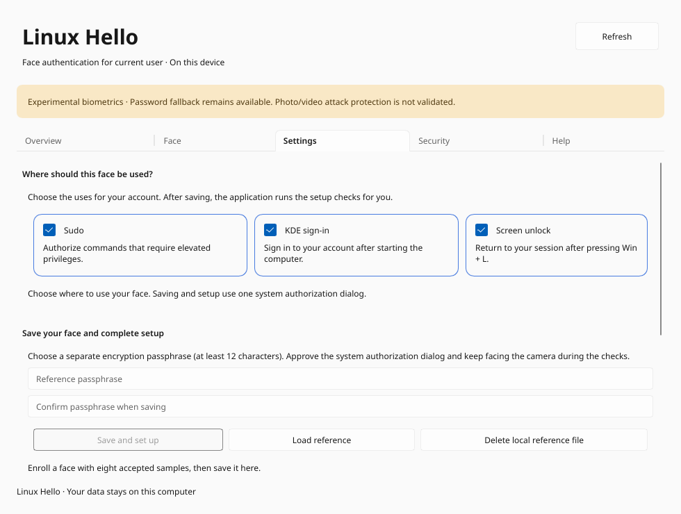

# Linux Hello

Linux Hello is a Rust application for local facial enrollment and verification on
Fedora Linux. It includes a Slint GUI, V4L2 camera diagnostics and optional PAM
integrations for sudo, desktop sign-in, KDE, Hyprlock and Noctalia unlocking.

**Development release: presentation attack detection (PAD) and representative
infrared FAR/FRR are not validated. Password fallback remains available.**
Models, camera images, biometric templates and keys are not distributed in this
repository. No cloud processing or runtime model download is required.



## Current status

| Area | Implemented behavior | Limitations |
| --- | --- | --- |
| Camera | V4L2 enumeration, GREY/RGB24/YUYV capture, preview, cancellation and scoped IR emitter control on the tested Chicony firmware | Other hardware, suspend/unplug and long-duration testing remain incomplete |
| Face pipeline | Pinned CPU YuNet detection, five-landmark alignment and 128-dimensional SFace embeddings through an isolated OpenCV worker | RGB-trained models are not qualified for a representative NIR population |
| Enrollment | Eight quality-checked samples, named local reference, encrypted save/load, versioned V1/V2 templates | One GUI reference; labels are not OS account identities |
| Verification | Three distinct suitable frames, centroid/exemplar/geometry checks, provisional minimum cosine threshold 0.80 | No mandatory head turns; no validated PAD or calibrated FAR/FRR |
| sudo | Protected root-owned reference, UID-bound verifier, original password fallback | Separate experimental opt-in |
| KDE login | Plasma Login Manager/SDDM PAM integration with independent account/service opt-in | Owner confirmed real Plasma login; SDDM is implemented but not physically validated here |
| KDE unlock | Self-account KScreenLocker integration for Win + L through a restricted setuid launcher | Owner confirmed unlocking on Fedora KDE |
| Hyprland / Noctalia unlock | Self-account Hyprlock and Noctalia 5.3.0 PAM adapters with independent opt-in | Implemented; see [activation and validation scope](docs/hyprland-noctalia.md) |
| Account management | Authorized self-account status, pause and confirmed reference removal in GUI/CLI | Metadata status does not perform live verification |
| Installation health | Metadata-only GUI/CLI report with pinned model checks | Not an authentication or PAD result |
| Diagnostic daemon | Read-only D-Bus status and bus-derived requester UID | No enrollment or authentication authority |
| Fingerprints | fprintd discovery and enrolled-finger status | Enrollment/removal UI is not implemented |
| Packaging | Full Fedora source installer, diagnostic RPM specification and manual PAM alternatives | RPM lifecycle and broad desktop/security qualification remain release gates |

Default builds provide diagnostics. Explicit features enable inference, the GUI
face workflow and PAM adapters. Installing diagnostic packages does not enable
PAM, start services or select an authselect profile. See the
[documentation index and scope](docs/index.md).

## Install on Fedora

Recommended full installation (run as your desktop user, without sudo):

```sh
./install.sh
```

The installer handles Fedora dependencies, pinned Rust, tests, full compilation,
verified model downloads, fixed-path helpers and the desktop launcher. Activate
selected uses through the GUI after installation. See the
[complete installation guide](docs/install-fedora.md) for first-time setup,
offline/build-only options, TPM, update and recovery.

For an existing Hyprland + Noctalia 5.3.0 desktop, use the complete profile installer:

```sh
./install-hyprland-noctalia.sh --open-settings
```

It installs the same full bundle and checks desktop compatibility. Explicit
activation options and offline/update instructions are in the
[Hyprland + Noctalia installation guide](docs/install-hyprland-noctalia.md).

## Build and run

Use the pinned toolchain in `rust-toolchain.toml` and `Cargo.lock`. Install the
Fedora development libraries in [installation](docs/installation.md).

```sh
cargo build --locked --workspace
cargo run --locked -p hello-cli -- cameras
cargo run --locked -p hello-cli -- security
cargo run --locked -p hello-settings
```

Choose the device from `cameras`; device numbers are host-specific. The tested
Lenovo uses `/dev/video2` for GREY/IR. The GUI starts with its camera off and runs
as the ordinary desktop user. No camera frames are sent through D-Bus.

For face enrollment and recognition, install the documented OpenCV prerequisites,
explicitly fetch pinned models, and build GUI plus its adjacent worker:

```sh
python3 tools/fetch-face-models.py --output work/inference/models
cargo build --locked --release -p hello-cli -p hello-settings \
  --features hello-settings/face-diagnostics
LINUX_HELLO_MODELS="$PWD/work/inference/models" target/release/hello-settings
```

The download output must be a new directory. Keep `hello-face-worker` next to
`hello-settings` and the optional `hello` CLI. Exact artifacts, preprocessing and
worker limits are in [inference](docs/inference.md).

## Scan, name and recognize

1. In **Face**, select the camera and, on supported hardware, IR illumination.
   Close preview before enrollment or verification.
2. Choose **Scan a new face**. Capture eight valid samples following the position
   instructions. Three frontal anchors come before moderate pose variation.
3. Enter a name and choose **Name this face**. The name is a local label.
4. Choose **Scan and recognize** and look straight at the camera. Three suitable
   matching frames are required; normal verification does not require head turns.
5. After naming, Settings opens with three cards: **Sudo**, **Desktop sign-in**
   and **Screen unlock**. Choose the uses, enter a separate reference passphrase
   twice and select **Save and set up**. A system Polkit prompt authorizes
   protected import and the selected live PAM checks in one guided operation.
   Keep facing the camera until completion; loading after restart remains explicit.

**Stop** cancels capture and awaits cleanup. **Resume scan** resumes accepted
samples; **Cancel enrollment** preserves the previous reference. A scan alone does not change the system reference. **Save and set up**
updates the protected reference and selected services after administrator
authorization. Interrupted system changes use a durable recovery journal; unknown
changes require administrator review. V1/V2 files remain readable, but the
[2026-10-18 pipeline update](docs/audit-remediation-2026-10-18.md#pipeline-compatibility-and-re-enrollment)
requires fresh enrollment after installing the complete matching bundle. New
system profiles require TPM wrapping; legacy providers require explicit migration. Details are in [biometrics](docs/biometrics.md)
and [inference](docs/inference.md).

## System setup from the GUI

Install the optional root helpers as described below first. The GUI starts on
**Face**, discovers cameras without capture and prefers an IR candidate. Installed
models are selected automatically when present. After scanning and naming, choose
the three application cards and use **Save and set up**. You do not need to run
three activation scripts manually. All existing face/PAM checks still execute;
partial checks never count as successful setup. No raw embeddings or account
passwords are sent by the GUI. The reference passphrase crosses a bounded private
pipe, not argv, environment or a file.

Unchecking a use disables it for this account after saving the configuration.
A per-account sudo disable preserves other enrolled users. **Developer mode**
in Settings reveals models, threshold tests, metadata, motion diagnostics and the
local-only save. Default user mode uses English instructions. User labels may use any supported Unicode name.

## Account management and health

Overview shows your local face and provides an authorized **Check system status**.
Settings includes **Pause face authentication** and confirmed **Remove system
reference** for your own account. Pausing retains the reference; removal deletes
its system template/key while keeping password fallback and the local GUI file.
Other accounts stay enabled. Resume through the normal live-checked GUI setup.

```sh
hello account status
hello account pause
hello account remove --confirm
hello doctor
hello doctor --json
```

The doctor starts no camera stream and includes no biometric data. Full details:
[account controls](docs/account-management.md) and the
[related-project comparison](docs/project-comparison.md).

## Manual system authentication setup

Provision sudo first using [sudo installation and recovery](docs/sudo-integration.md).
The unified GUI setup helper is installed by the KDE installer. KDE integrations
reuse that account's protected reference without a new face scan for enrollment. Each integration is enabled independently after its live checks.
Run these installed scripts as the normal desktop user:

```sh
# Import the encrypted GUI reference and enable sudo:
/usr/local/libexec/linux-hello-sudo/enroll-and-enable.sh
# Enable KDE display-manager login:
/usr/local/libexec/linux-hello-sudo/activate-kde.sh
# Enable KDE session unlocking after Win + L:
/usr/local/libexec/linux-hello-sudo/activate-lock.sh
# Enable Noctalia / Hyprlock screen unlocking (auto-detected):
/usr/local/libexec/linux-hello-sudo/activate-desktop.py
```

The scripts are available only after the corresponding manual installation.
The GUI reference passphrase is distinct from the account password. Never put
passwords, keys or templates into shell arguments, environment variables or Git.
For KDE login, select the account and submit an empty password field while facing
the camera. For Win + L, show the unlock screen; if scanning does not start,
submit the empty field. Password fallback remains available. KWallet can request
its own password. See [KDE installation, activation and rollback](docs/kde-login.md).

Supported PAM services are `sudo`, `sudo-i`, `plasmalogin`, `sddm`, `kde`,
`hyprlock` and self-account `login` for Noctalia 5.3.0. Root TTY login remains on
its original policy. GDM, greetd/Noctalia Greeter, sshd, su and Polkit agents
are not integrated. See [Hyprland and Noctalia](docs/hyprland-noctalia.md).
The diagnostic daemon's disabled readiness flags do not report the activation
state of the separate experimental PAM adapters.

## Development checks

```sh
cargo fmt --all --check
cargo clippy --locked --workspace --all-targets -- -D warnings
cargo test --locked --workspace
python3 -B -m unittest discover -s tests -p 'test_*.py'
bash tests/integration/run-session.sh
python3 tools/check-docs.py
cargo build --locked --workspace --release
cargo audit --deny warnings
cargo deny --locked check licenses sources bans
```

Strict dependency auditing has known maintenance blockers in the recorded
[audit snapshot](docs/dependencies.md); it must not be reported as a clean gate.
Default tests never acquire a camera or install PAM. Optional inference, hardware
and privileged dispatch tests have explicit entry points in [tests](tests/README.md).
[Validation](docs/validation.md) separates current evidence from historical results.

## Documentation and licensing

Start with the [documentation index](docs/index.md), [architecture](docs/architecture.md),
[authentication flow](docs/authentication-flow.md), [threat model](docs/threat-model.md)
and [security policy](SECURITY.md). Contributing instructions are in
[CONTRIBUTING.md](CONTRIBUTING.md).

Shared crates are Apache-2.0 ([LICENSE](LICENSE)); the Slint GUI is GPL-3.0-only
([LICENSE-GPL-3.0](LICENSE-GPL-3.0)). GUI distribution requires corresponding source
and notices. Code licensing does not establish pretrained weight/data rights;
no weights are distributed. Windows Hello-equivalent security is not claimed.

## Contributors

Maintained by [Jan-Bladek](https://github.com/Jan-Bladek), with AI-assisted development
by **OpenAI Codex**.

The [technical audit remediation tracker](docs/audit-remediation.md) documents
implemented security fixes, upgrade requirements and remaining release blockers.
