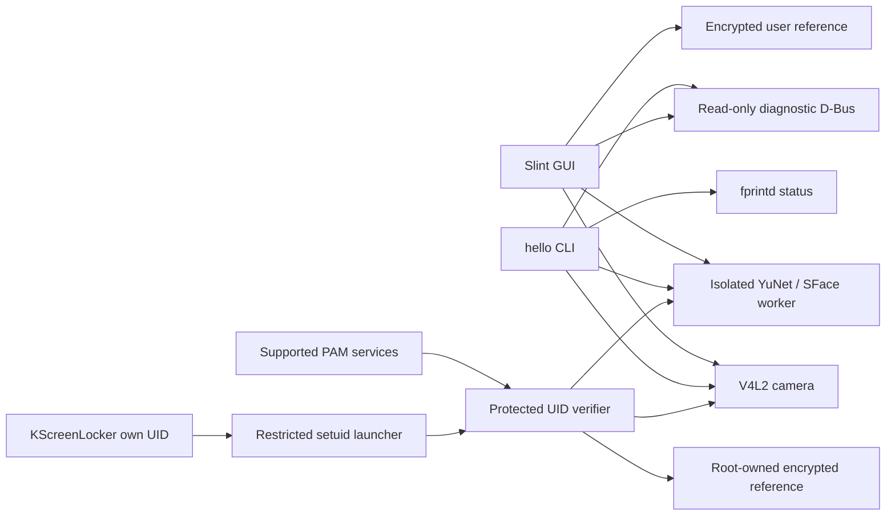

# Architecture

Linux Hello 0.1.0-dev is a modular development preview for local camera diagnostics
and experimental local facial authentication. It is not a security-qualified
authentication product release. Read the
[threat model](threat-model.md) before changing any boundary described here.

## Components and authority

| Component | Responsibility | Authority in this version |
|---|---|---|
| `hello-core` | Shared validated types, capability states, lifecycle policy | Pure library; cannot grant OS access |
| `hello-camera` | Camera abstraction, Linux V4L2 enumeration and bounded capture | Current user's existing device access |
| `hello-face` | Pinned optional YuNet/SFace, quality, model-bound matching and versioned templates | Supplies evidence to GUI/root verifier; no standalone OS authorization or validated PAD |
| `hello-storage` | UID-bound AEAD records, private atomic storage and administrator import | GUI passphrase keys or separate root-owned PAM key; TPM wrapping required for new system profiles; legacy migration is explicit, no key service |
| `hello-ipc` | Versioned diagnostic contract and zbus client | Read-only daemon diagnostics |
| `hello-daemon` | Diagnostic D-Bus endpoint, capability reporting, shutdown | Unprivileged service; no camera or secret access |
| `hello-fingerprint` | fprintd discovery/status adapter | fprintd retains driver, policy and template ownership |
| `hello-pam` | Optional PAM adapter and self-only locker launcher | Explicit sudo/KDE feature, supported caller/service only; password fallback |
| `hello-sudo` | Fixed root verifier and protected template import | Root-owned UID profiles; authenticates only after matching and cleanup |
| `hello-cli` / `hello` | Diagnostics, local face tools and evaluation | Does not edit PAM; explicit root management scripts handle activation |
| `hello-settings` | Slint preview, named enrollment and passive recognition | Ordinary desktop user; can request explicit authorized setup; cannot write root profiles directly |

The diagnostic daemon accepts no frames, templates or authentication requests.
PAM is a separate explicitly installed/activated route, not a D-Bus extension.
Ordinary GUI/CLI capture uses existing session device permissions. Do not grant
blanket video access to hide permission errors. See [authentication flow](authentication-flow.md).

## Linux and portable boundaries

V4L2 and system-bus access are platform-specific. Pure validation, encrypted
envelopes, matching and state-transition tests can run without Linux or hardware.
Camera simulation belongs in test fixtures and must never be selected as a real
authentication backend. Windows/WSL compilation does not validate Fedora service
policy, SELinux, IR emitters, physical cameras or Wayland behavior.

Camera enumeration should inspect actual capabilities and formats. A video node may
be metadata-only, RGB, IR, depth or another media interface. An IR hint is not a
liveness result. Capture must be explicit and bounded, release its descriptor on
completion/error/cancellation and treat unplug/replug as fresh discovery. The GUI
must not start continuous capture simply because the application launched.

## Diagnostic D-Bus contract

System service name/interface: `org.linuxhello.Daemon1`.
Object path: `/org/linuxhello/Daemon1`.
The executable defaults to the system bus; `--session` selects an explicitly
untrusted development instance. Consult `hello-ipc` and D-Bus introspection for the
implemented method signatures. Public version/security/capability reporting is
intentionally readable by local callers. D-Bus name ownership is restricted by the
packaged system-bus policy to the `linux-hello` service account (and root).

The system unit runs as that account with an empty capability set, private devices,
read-only filesystem, no writable state directory, AF_UNIX-only networking, memory
and task limits and a closed device policy. This is sufficient only for the current
read-only scope. A future sensor/secret daemon needs a new reviewed unit and policy;
removing its restrictions wholesale is not an acceptable migration.

The diagnostic service has no D-Bus activation file, socket activation, autostart
or RPM service enablement. Installation and deliberate service startup are distinct actions.
Diagnostic properties are not evidence that authentication can be enabled.

## Biometric and storage boundaries

The engine interface separates detection, alignment, embedding and quality from
PAD. Matching validates dimensions and numerical values; thresholds remain model
and population dependent. No model is selected solely because it exports ONNX.
Model license, preprocessing, sensor applicability, accuracy and adversarial
evaluation must all be known. Runtime and model checksums must be tracked together.

GUI enrollment and administrator-authorized import use the storage library.
The fixed pkexec setup helper coordinates selected sudo/KDE managers, derives
its own subject UID, serializes setup and restores prior files on ordinary failure.
It is separate from the diagnostic daemon.
The GUI key is passphrase-derived; PAM profiles use separate random root-owned
keys and protected ancestry. [TPM key wrapping](tpm.md) is required for new system profiles; legacy migration
is explicit and there is no measured-boot policy. No general-purpose privileged
management daemon is implemented. A diagnostic test key is not an auth credential.
Deletion unlinks the
record; it does not guarantee secure erasure on SSDs, snapshots or backups.

## Implemented milestones and remaining release gates

Workspace, physical target camera/IR, named encrypted enrollment, passive
verification and narrow optional sudo/KDE PAM integrations are implemented.
Owner-confirmed Plasma login and Win + L are functional evidence on one host.

Remaining gates include representative sensor/model/PAD evaluation; independent
code/key/privilege review; authenticated general-purpose management IPC; broader
desktop/hardware testing; disposable-VM recovery; and RPM lifecycle/upgrade review.
Default diagnostic capability flags do not become security-qualified merely
because an experimental PAM service has been explicitly enabled.

See [authentication flow](authentication-flow.md), [installation](installation.md)
and [upstream research](research.md) for the concrete gates and operating steps.

## Self-account management and health

`manage-person.py` is a fixed root-owned sibling authorized by pkexec/sudo, bound
to the trusted subject UID. It provides management metadata, pause and confirmed
removal without a camera or authentication verdict. Changes reuse existing service
managers, serialize on the setup lock and restore snapshots on expected failures.
The GUI and CLI use bounded replies with exact UID/action checks. The unprivileged
health report lives in `hello-cli`; it never accesses protected reference contents.
See [account controls](account-management.md).
