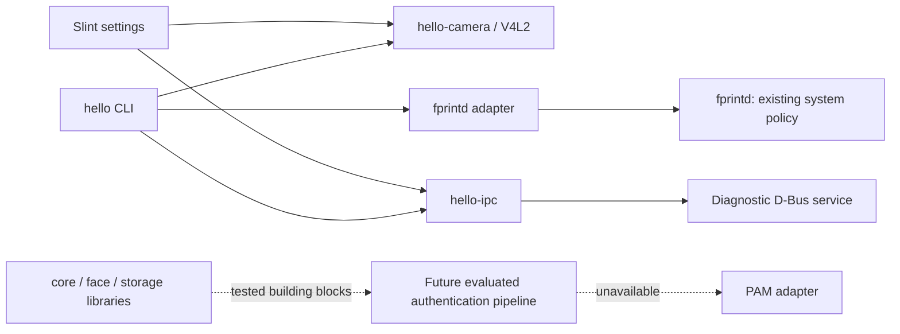

# Architecture

Linux Hello 0.1.0-dev is a modular development preview for local camera diagnostics
and security engineering. It is not an authentication product release. Read the
[threat model](threat-model.md) before changing any boundary described here.

## Components and authority

| Component | Responsibility | Authority in this version |
|---|---|---|
| `hello-core` | Shared validated types, capability states, lifecycle policy | Pure library; cannot grant OS access |
| `hello-camera` | Camera abstraction, Linux V4L2 enumeration and bounded capture | Current user's existing device access |
| `hello-face` | Replaceable engine/PAD interfaces, quality/matching utilities | No approved model or PAD; cannot authenticate |
| `hello-storage` | Versioned AEAD records and private local storage primitives | Caller-provided keys; no deployed trusted key service |
| `hello-ipc` | Versioned diagnostic contract and zbus client | Read-only daemon diagnostics |
| `hello-daemon` | Diagnostic D-Bus endpoint, capability reporting, shutdown | Unprivileged service; no camera or secret access |
| `hello-fingerprint` | fprintd discovery/status adapter | fprintd retains driver, policy and template ownership |
| `hello-pam` | Fail-closed integration boundary and readiness documentation | No installable PAM module or success-producing adapter |
| `hello-cli` / `hello` | Device checks, capture diagnostics, readiness | Never alters PAM or service enablement |
| `hello-settings` | Slint settings/diagnostics and explicit preview | Ordinary desktop user; no privileged UI |

The dotted edges are release gates, not implemented authorization routes. The
diagnostic daemon does not accept camera frames, usernames or secrets. Ordinary
clients access a camera only if the user's session already has permission. Do not
add all users to `video` or make `/dev/video*` world-readable to bypass a permissions
error.

## Linux and portable boundaries

V4L2 and system-bus access are platform-specific. Pure validation, encrypted
envelopes, matching and state-transition tests can run without Linux or hardware.
Camera simulation belongs in test fixtures and must never be selected as a real
authentication backend. Windows/WSL compilation does not validate Fedora service
policy, SELinux, IR emitters, physical cameras or Wayland behavior.

Camera enumeration should inspect actual capabilities and formats. A video node may
be metadata-only, RGB, IR, depth or another media interface. An IR hint is not a
liveness result. Capture must be explicit and bounded, release its descriptor on
completion/error/cancellation and treat unplug/replug as fresh discovery. The GUI
must not start continuous capture simply because the application launched.

## Diagnostic D-Bus contract

System service name/interface: `org.linuxhello.Daemon1`.
Object path: `/org/linuxhello/Daemon1`.
The executable defaults to the system bus; `--session` selects an explicitly
untrusted development instance. Consult `hello-ipc` and D-Bus introspection for the
implemented method signatures. Public version/security/capability reporting is
intentionally readable by local callers. D-Bus name ownership is restricted by the
packaged system-bus policy to the `linux-hello` service account (and root).

The system unit runs as that account with an empty capability set, private devices,
read-only filesystem, no writable state directory, AF_UNIX-only networking, memory
and task limits and a closed device policy. This is sufficient only for the current
read-only scope. A future sensor/secret daemon needs a new reviewed unit and policy;
removing its restrictions wholesale is not an acceptable migration.

There is no D-Bus activation file, socket activation, autostart, or RPM service
enablement. Installation and deliberate service startup are distinct actions.
Diagnostic properties are not evidence that authentication can be enabled.

## Biometric and storage boundaries

The engine interface separates detection, alignment, embedding and quality from
PAD. Matching validates dimensions and numerical values; thresholds remain model
and population dependent. No model is selected solely because it exports ONNX.
Model license, preprocessing, sensor applicability, accuracy and adversarial
evaluation must all be known. Runtime and model checksums must be tracked together.

The storage library exercises authenticated encryption and filesystem safety. It
does not provide an enrollment ceremony or TPM key lifecycle. A generated test key
or same-user local key is not a privileged daemon credential. Deletion unlinks the
record; it does not guarantee secure erasure on SSDs, snapshots or backups.

## Release progression

1. Establish buildable workspace and explicit threat boundaries.
2. Validate real camera enumeration/capture on the target Fedora hardware.
3. Select licensed models, implement inference and independent evaluated PAD;
   demonstrate local enrollment only after trusted authorization is designed.
4. Review and test authenticated, request-bound system IPC and secret storage.
5. Finish accessible desktop workflows and hardware error recovery.
6. Implement narrow PAM integration and validate supported stacks in disposable
   Fedora VMs with rollback and password recovery.
7. Validate RPM upgrade/removal, SELinux, GNOME/KDE/Hyprland and physical attacks
   before calling any release candidate suitable for authentication.

See [authentication flow](authentication-flow.md), [installation](installation.md)
and [upstream research](research.md) for the concrete gates and operating steps.
