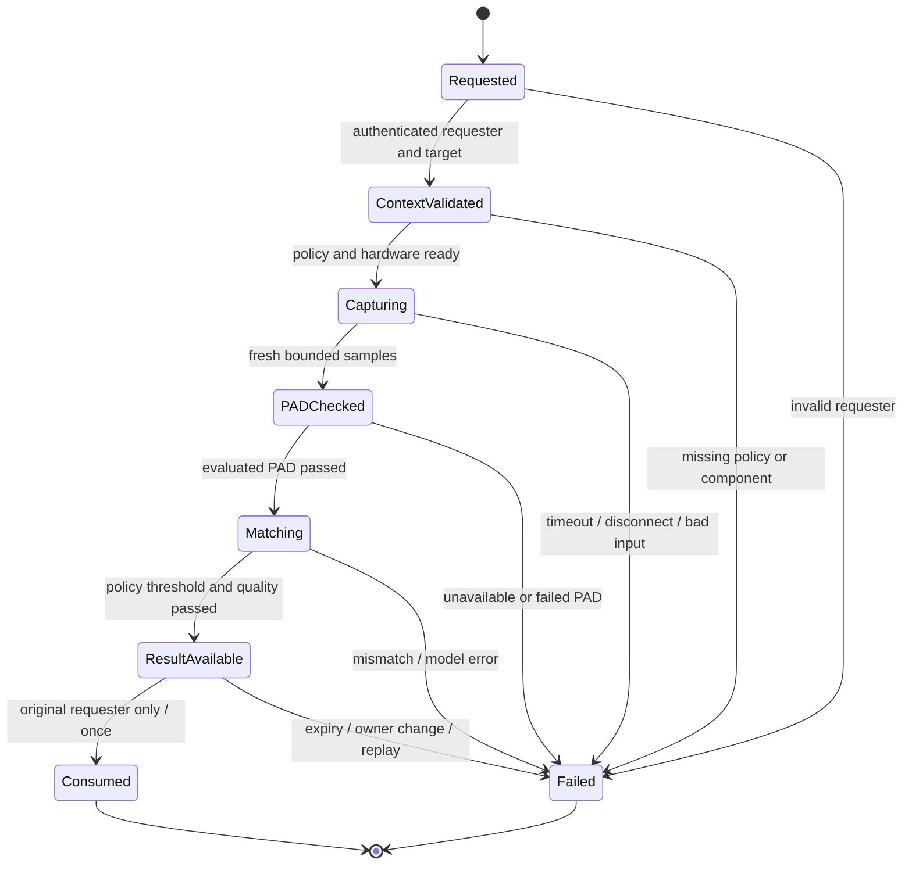

# Authentication and enrollment flow

## What exists now

Version 0.1.0-dev provides diagnostics and tested library building blocks. Face
authentication, trusted enrollment and a loadable PAM module are unavailable. The
GUI must show this state, and commands must not reinterpret a test similarity result
as identity verification. There is no administrator switch that safely removes the
missing-model or missing-PAD gates.

Public diagnostic RPCs contain no identity parameters, authorization requests or
biometric material. The library state machine is a policy building block, not a
live daemon verification protocol. Session-bus tests validate transport behavior
only; a user can control their own session bus.

## Future enrollment transaction (not implemented)

1. Resolve the caller's unique system-bus name through the broker and determine the
   caller's UID/session. Validate an explicit target UID under service policy.
2. Obtain fresh trusted system authentication for enrollment. Bind the Polkit
   authorization to the authenticated bus subject, intended action and target.
   Do not request the user's password through a Linux Hello-owned dialog.
3. Reserve one sensor and establish a bounded operation tied to the caller and a
   monotonic deadline. Check model, sensor and PAD readiness before any capture.
4. Collect multiple samples, reject unsupported inputs, require the evaluated PAD
   protocol and enforce quality/diversity criteria. A fixed count of similar frames
   is not evidence of sufficient enrollment quality.
5. Produce a versioned template bound to UID, model/preprocessing identity and sensor
   policy. Encrypt with an established AEAD and a service-controlled key.
6. Recheck authorization and atomically commit the private encrypted record. Return
   only enrollment status after persistence succeeds; never return a template.
7. On cancellation, timeout, disconnection, authorization loss or failure, release
   the sensor and discard pending data. An incomplete enrollment is never active.

Deletion requires the same explicit account scope and a fresh authorization policy.
Report absence separately from inability to remove; document backup retention and
the limits of file deletion. Do not delete fprintd-owned templates from this store.

## Future verification transaction (not implemented)

This is a target protocol, not a promise that the current library contains every
state shown. Every transition must be checked server-side; concurrent callers must
not share mutable verification results. Cancel/disconnect invalidates the pending
operation even if a late worker result arrives. A request ID locates state and is
never sufficient authorization on its own.

## PAM and password preservation

A future PAM module must be narrow: obtain verified PAM context, communicate with
the authenticated system daemon, enforce a short timeout, map failures correctly
and return without leaking secrets. It must not load inference models, manipulate
camera controls or run shell commands inside the authenticating process. No mock
success return path is permitted in production builds.

PAM codes describe a module outcome; stack control flags determine whether the
application ultimately permits login. `PAM_AUTHINFO_UNAVAIL` and an ordinary
authentication failure must never be confused with biometric success. The
[Linux-PAM upstream contract](https://github.com/linux-pam/linux-pam/blob/master/doc/man/pam_sm_authenticate.3.xml)
documents module return codes. Their interaction with each Fedora profile still
requires testing.

Password fallback must retain account restrictions, lockout, password expiration,
session setup and existing fingerprint behavior. sudo, GDM, SDDM, each screen
locker and each Polkit agent may drive conversations differently. PAM support does
not imply that all of them will show the expected prompts. Keyring and encrypted
home/disk unlock are separate integrations and must not be silently changed.

The [authselect review procedure](../packaging/authselect/README.md) intentionally
contains no loadable PAM template or activation script. Recovery is part of the
release acceptance criteria, not an instruction to test an unsafe stack on a host.
