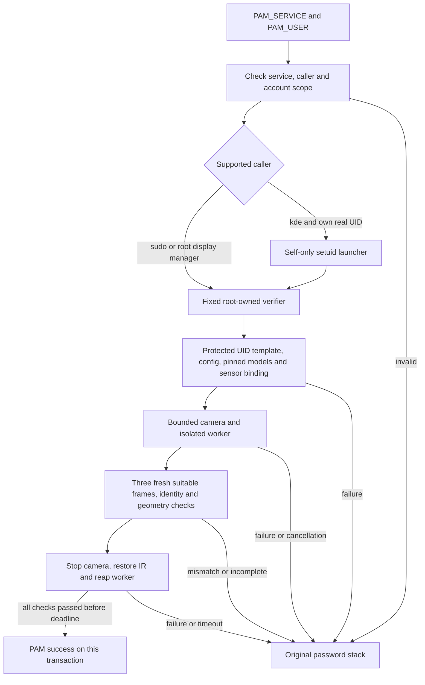

# Enrollment and authentication flow

This guide describes the current experimental implementation. Security
qualification and future authenticated D-Bus management are separate work.
See [scope](index.md) and [threat model](threat-model.md).

## GUI enrollment

1. The ordinary user selects an enumerated camera and optional supported IR mode.
2. An explicit scan starts one bounded camera session and isolated loaded worker.
3. Eight distinct valid frames are collected. New V2 templates begin with three
   frontal anchors, then moderate pose variation. Quality and consistency failures
   do not add samples. Cancellation preserves the previous reference.
4. The user supplies a local display name; it does not select an OS identity.
5. An explicit save encrypts name and template using a separate passphrase-derived
   key. Load/deletion are separate user actions; startup opens no saved reference.

GUI verification compares three suitable fresh frames with the selected reference.
It requires compatible model, sensor/IR binding, geometry and threshold evidence.
A below-threshold/incompatible face, multiple faces, malformed data or incomplete
scan cannot produce positive recognition. This does not imply a measured zero FAR.
The optional head-motion diagnostic is not part of normal
verification and is not validated PAD.

## Protected PAM provisioning

The sudo enrollment helper requires administrator authorization and a normal NSS
account UID. It reads the GUI reference passphrase through a masked terminal,
checks private user-owned files and imports a complete compatible reference.
It encrypts a separate copy with a random root-owned key under
`/var/lib/linux-hello/sudo/<uid>`. The manual import leaves the GUI reference unchanged. Each profile
has UID-bound template/config/key files; unprivileged local-only GUI edits cannot change them.

A live verification confirms the import. sudo activation requires another match,
backs up the original service file and preserves the original password stack.
KDE login and unlock have independent `pam-SERVICE.enabled` markers and two live
pre-activation tests; they reuse the protected reference. See [sudo](sudo-integration.md)
and [KDE](kde-login.md) for exact commands, permissions and rollback.

## Unified GUI configuration

After scan/name, the user chooses sudo, KDE login and unlock. Explicit **Zapisz i
skonfiguruj** saves the GUI reference and launches the fixed installed setup
helper via pkexec. A bounded private stdin pipe carries choices/source directory
and the reference passphrase, not the account password or biometric vectors.
The helper derives the subject UID from pkexec, authorizes no alternate target,
imports and live-verifies the protected reference, then runs selected managers.
It preserves the existing root threshold and restores prior root profile/PAM files
on ordinary failure or result-pipe disconnection. A separate per-user sudo disable
does not alter other users' authorization. No broad Polkit/D-Bus management API
was added. Hard kill/power loss may require recovery.

## Verification transaction

The helper returns success only after verification and cleanup complete. PAM
expires the attempt at25 seconds, requests graceful cancellation, then kills and
reaps a hung child after another10 seconds. A late successful exit cannot be used.
Every new PAM authentication clears its per-handle match marker. Credential
establishment succeeds only after this adapter's own successful transaction;
failed retries cannot reuse an earlier result. No GUI score or D-Bus token is
accepted as authentication proof.

## Password and desktop behavior

sudo retains sudoers authorization and original account/password/session includes.
For KDE, a dedicated authentication substack records biometric success and ends
only that inner stack; rejection executes `password-auth`. Parent SELinux,
wallet/postlogin and other original groups remain. Earlier required denial is not
overridden. Account/session policy is still controlled by the host and calling
application; KScreenLocker checks authentication and refreshes credentials rather
than opening a new desktop session. KWallet may separately need its password.

Only `sudo`, `sudo-i`, `plasmalogin`, `sddm` and `kde` are integrated. GDM, tty
login, sshd, su, Polkit and other lockers remain outside scope. Default installation
never edits production PAM or authselect. Explicit activation does edit the named
service after its checks. Disk encryption and encrypted-home unlock are unchanged.

## Diagnostic D-Bus and future management

The daemon remains read-only. It resolves requester UID through the bus and
accepts no identity-bearing enrollment/verification request, frame or key.
Its disabled security-readiness flags describe the diagnostic contract, not the
activation state of optional PAM integrations.

A future general-purpose management service requires reviewed requester/target
binding, fresh trusted authorization, operation deadlines, disconnect handling,
one-shot result consumption and protected key lifecycle. This protocol and Polkit
management are not implemented. See the [authselect design and VM recovery
procedure](../packaging/authselect/README.md) before extending supported stacks.
